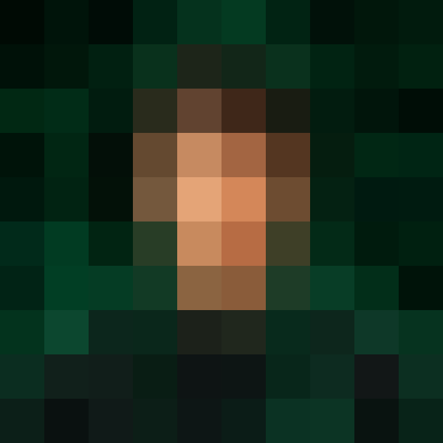

 

<table>
<tr>
<td width="62%" valign="middle">

<h1 align="left">SARFRAZ CODES</h1>

<h3 align="left">

</h3>

**Computer Science Student**

Building intelligent applications, experimenting with machine learning, and developing software that solves real problems.

 

 

[GitHub](https://github.com/sarfrazcodes) · [LeetCode](https://leetcode.com/u/sarfrazcodes/) · [Codeforces](https://codeforces.com/profile/sarfrazcodes)

</td>
<td width="38%" align="center" valign="middle">

</td>
</tr>
</table>

---

## About Me

- B.Tech Computer Science student.
- Interested in Artificial Intelligence, Machine Learning, NLP and LLMs.
- Building full-stack applications and intelligent backend systems.
- Practicing Data Structures and Algorithms.
- Currently developing **EVA AI OS**, a voice-controlled desktop assistant.
- Exploring AI/ML, Backend Engineering and SDE opportunities.

---

## Tech Stack

**Programming Languages**

**AI / Machine Learning**

**Development & Databases**

---

## Featured Projects

| Project | Description |
|:---|:---|
| [EVA AI OS](https://github.com/sarfrazcodes/evaAiOs) | Voice-controlled desktop assistant with AI and OS automation. |
| [KrishiSetu](https://github.com/sarfrazcodes/krishisetu_final) | AI-powered agricultural market intelligence platform. |
| [UMS ChatBot](https://github.com/sarfrazcodes/umsChatBot) | University chatbot using NLP, NLTK and RapidFuzz. |
| [Career Buddy](https://github.com/sarfrazcodes/career_buddy) | Career assistance application. |
| [Land Viewer](https://github.com/sarfrazcodes/land_viewer) | Interactive land visualization application. |

---

## Competitive Programming

<table>
<tr>
<td width="50%" align="center" valign="middle">

</td>
<td width="50%" align="center" valign="middle">

</td>
</tr>
</table>

---

## GitHub Overview

---

## Contribution Activity

---

## Let's Connect

  

**Building today what I wish existed yesterday.**

